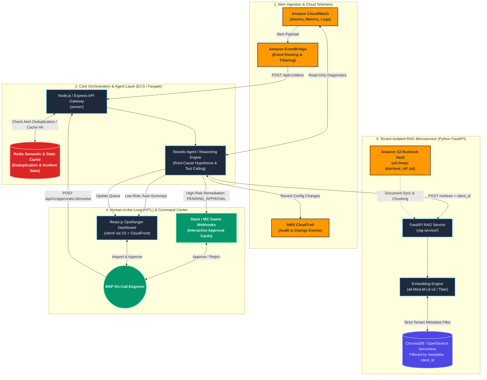
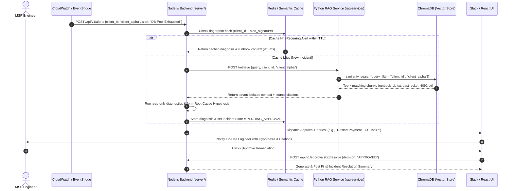

# 🛡️ OpsRanger: Incident Copilot (Amazon MSP Hackathon)

[](https://aws.amazon.com/)
[](https://nodejs.org/)
[](https://fastapi.tiangolo.com/)
[](https://react.dev/)
[](https://www.trychroma.com/)

**OpsRanger: Incident Copilot** is an autonomous, multi-tenant **Alert-to-Resolution AI Agent** engineered for **Managed Service Providers (MSPs)**. 

When cloud infrastructure alerts fire across hundreds of client accounts, junior on-call engineers often lack context regarding each client's unique architecture, past incidents, and custom runbooks. OpsRanger ingests incoming alerts, enforces strict tenant isolation (`client_id`) via Retrieval-Augmented Generation (RAG), executes safe read-only diagnostics, pauses high-risk remediations for **Human-in-the-Loop (HITL)** approval via Slack/Teams or the dashboard, and generates comprehensive post-incident summaries.

---

## 🏗️ Production System Architecture

OpsRanger utilizes a **polyglot microservice architecture** designed for low-latency alert triage, strict multi-tenant data isolation, and strategic caching.

> *Note: The diagrams below are rendered natively using GitHub-compatible Mermaid syntax.*



---

## 🔄 Alert-to-Resolution Execution Flow (Sequence Diagram)

The following sequence illustrates how an incoming alert is deduplicated, enriched with tenant-isolated runbooks, diagnosed, and safely gated behind human approval:



---

## ⚡ Production Caching & Multi-Tenant Security Strategy

### 1. Multi-Layer Caching Architecture
To guarantee sub-second response times during alert storms and reduce redundant compute/LLM costs:
* **Alert Deduplication Cache:** Hashes incoming `(client_id + alert_name + resource_id)` with a configurable TTL (e.g., 5 minutes) to prevent duplicate incident threads when flapping CloudWatch alarms fire repeatedly.
* **Semantic Query Cache:** Caches frequent alert embeddings and their top-$k$ retrieved runbook chunks per `client_id` so recurring infrastructure issues bypass vector search overhead.
* **Persistent Embedding Model Cache:** Pre-loads `all-MiniLM-L6-v2` into memory at FastAPI startup so inference takes milliseconds without cold-start downloads.

### 2. Strict Multi-Tenant Isolation (`client_id`)
In an MSP environment, leaking **Client Alpha's** architecture or credentials into **Client Beta's** incident response is a critical security failure:
* Every ingested document chunk is stamped with mandatory metadata: `{"client_id": "<tenant>", "doc_type": "runbook|post_mortem|ticket", "source_file": "..."}`.
* All vector similarity queries enforce a hard pre-filter (`filter={"client_id": request.client_id}`) at the database level prior to distance scoring.

---

## 🗂️ Repository File Structure

```text
incident-copilot/
├── .env.example                     # Environment variable template
├── .gitignore
├── README.md                        # System architecture & documentation
│
├── client/                          # === FRONTEND (React.js / Vite / Tailwind) ===
│   ├── package.json
│   ├── vite.config.js
│   ├── tailwind.config.js
│   ├── index.html
│   └── src/
│       ├── main.jsx
│       ├── App.jsx
│       ├── components/              # Reusable UI (Navbar, AlertCard, ApprovalActionBox)
│       ├── pages/                   # Dashboard, IncidentDetail, ApprovalsQueue, Runbooks
│       └── services/                # Axios API clients
│
├── server/                          # === BACKEND ORCHESTRATOR (Node.js / Express) ===
│   ├── package.json
│   └── src/
│       ├── index.js                 # Express server entry point
│       ├── controllers/             # alert.controller.js, approval.controller.js
│       ├── routes/                  # /api/v1/alerts, /api/v1/approvals, /api/v1/incidents
│       ├── services/
│       │   ├── agent.service.js     # Coordinates RAG calls, diagnostics & hypothesis
│       │   ├── aws-tools.service.js # Read-only CloudWatch/CloudTrail diagnostic checks
│       │   └── notification.service.js # Slack / Teams webhook dispatcher
│       └── middlewares/             # Payload validation & centralized error handling
│
└── rag-service/                     # === RAG MICROSERVICE (Python / FastAPI) ===
    ├── requirements.txt             # FastAPI, LangChain, ChromaDB, HuggingFace
    ├── main.py                      # FastAPI server exposing /retrieve & /ingest
    ├── chroma_db/                   # Persistent local vector database storage
    ├── data/                        # Tenant-segregated knowledge base (.txt runbooks)
    │   ├── client_alpha/
    │   │   ├── runbook_db.txt
    │   │   └── past_ticket_4092.txt
    │   └── client_beta/
    │       └── runbook_cpu.txt
    └── src/
        ├── __init__.py
        ├── ingest.py                # RecursiveCharacterTextSplitter & metadata tagging
        ├── vectorstore.py           # ChromaDB & HuggingFace embedding initialization
        └── connectors.py            # Amazon S3 bucket runbook synchronization (boto3)
```

---

## 🛠️ Tech Stack & AWS Service Mapping

| Layer | Local / Hackathon MVP Stack | Production AWS Cloud Equivalent |
| :--- | :--- | :--- |
| **Alert Source & Routing** | Postman / Simulated JSON Webhooks | **Amazon CloudWatch** + **Amazon EventBridge** |
| **Backend Orchestrator** | Node.js + Express (`server/`) | **Amazon ECS (Fargate / Express Mode)** + **Amazon ECR** |
| **Agent & Reasoning** | Node.js Agent Service + Rule/LLM Loop | **Strands Agent on AgentCore** + **Amazon Bedrock** |
| **RAG Microservice** | Python + FastAPI (`rag-service/`) | **Amazon ECS** or **Amazon Bedrock Knowledge Bases** |
| **Embeddings** | `all-MiniLM-L6-v2` (Local, $0 API cost) | **Amazon Titan Text Embeddings** |
| **Vector Database** | ChromaDB (`./chroma_db` + EFS) | **Amazon OpenSearch Serverless** |
| **Document Storage** | Local `data/<client_id>/*.txt` | **Amazon S3** (Bucket prefixes per `client_id`) |
| **Frontend Dashboard** | React.js + Vite + Tailwind (`client/`) | **Amazon S3** + **Amazon CloudFront** (HTTPS CDN) |

---

## 🚀 Quick Start (Local Development)

### Prerequisites
* **Node.js** `v18+` and `npm`
* **Python** `3.10+`
* **Postman** (for API & tenant-isolation verification)

### 1. Start the Python RAG Microservice (`rag-service/`)
Runs 100% locally with **zero paid API keys required**:

```bash
cd rag-service
python -m venv venv

# Activate virtual environment:
# Windows:
venv\Scripts\activate
# macOS / Linux:
source venv/bin/activate

pip install -r requirements.txt
python main.py
```
> **Service active at:** `http://localhost:8000` (Interactive Swagger Docs: `http://localhost:8000/docs`)

### 2. Start the Node.js Backend Orchestrator (`server/`)

```bash
cd server
npm install
node src/index.js
```
> **Service active at:** `http://localhost:5000`

### 3. Start the React Frontend Dashboard (`client/`)

```bash
cd client
npm install
npm run dev
```
> **Dashboard active at:** `http://localhost:5173`

---

## 🧪 API Reference & Verification Tests

### 1. Trigger an Incoming Infrastructure Alert
**Endpoint:** `POST http://localhost:5000/api/v1/alerts`

```json
{
  "alert_message": "CRITICAL: Database connection pool exhausted on production RDS",
  "client_id": "client_alpha",
  "severity": "CRITICAL",
  "resource_id": "rds-prod-alpha-01"
}
```

**Sample Response:**
```json
{
  "incident_id": "INC-2026-8841",
  "client_id": "client_alpha",
  "status": "PENDING_APPROVAL",
  "root_cause_hypothesis": "Connection pool leak detected in payment microservice, matching historical Ticket #4092.",
  "retrieved_context": [
    {
      "content": "Step 1: Check active database connections via CloudWatch metrics. Step 2: Restart the offending ECS task gracefully...",
      "metadata": {
        "client_id": "client_alpha",
        "doc_type": "runbook",
        "source_file": "runbook_db.txt"
      }
    }
  ],
  "proposed_remediation": {
    "action": "RESTART_ECS_TASK",
    "risk_level": "HIGH",
    "requires_human_approval": true
  }
}
```

### 2. Verify Strict Tenant Isolation (`client_alpha` vs `client_beta`)
**Endpoint:** `POST http://localhost:8000/retrieve`

Send the exact same database query for `client_beta`:
```json
{
  "query": "How do I fix database connection exhaustion?",
  "client_id": "client_beta"
}
```
✅ **Expected Result:** Returns only `client_beta` documents (or an empty match array)—**never** leaking `client_alpha`'s database runbooks.

### 3. Approve or Reject High-Risk Remediation
**Endpoint:** `POST http://localhost:5000/api/v1/approvals/INC-2026-8841/resolve`

```json
{
  "decision": "APPROVED",
  "approved_by": "senior.engineer@msp-ops.io"
}
```

---

## ☁️ Production AWS Deployment Guide

1. **Containerize Services:** Build Docker images for `server/` (port `5000`) and `rag-service/` (port `8000`) and push both to **Amazon ECR**.
2. **Deploy Compute & Persistent Storage:**
   * Deploy both containers to **Amazon ECS (Fargate / Express Mode)**.
   * Mount an **Amazon EFS** volume to `/app/chroma_db` on the RAG task so vector embeddings persist across container restarts, and sync `.txt` runbooks from **Amazon S3**.
   * Set `PYTHON_RAG_URL` in the Node.js ECS task definition to the internal service discovery DNS of the Python RAG service.
3. **Host Frontend:** Run `npm run build` inside `client/`, upload `dist/` to an **Amazon S3** bucket, and serve globally over HTTPS via **Amazon CloudFront**.
4. **Connect Live Alerts:** Configure **Amazon CloudWatch Alarms** $\rightarrow$ **Amazon EventBridge** API Destinations to forward live alert payloads directly to `POST /api/v1/alerts`.
